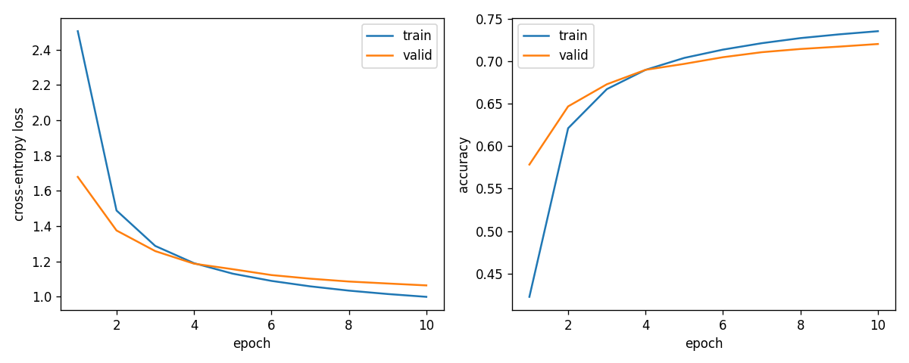
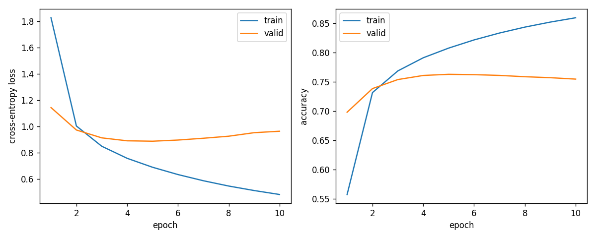

# Hidden-size ablation: 345-class BiLSTM

Anson's assigned experiment compares hidden sizes **128, 256, and 512 per direction**. The 128/512 runs completed on PSC on October 18–19, 2026; the unchanged 256 run from October 14 is reused as the baseline. This is a comparison of from-scratch classifiers, not fine-tuning.

## Validation results

- **Hidden 128:** best validation accuracy **72.02%**, loss **1.0643998329**, at epoch **10**. [Metrics](hidden128_metrics_valid.json), [history](hidden128_history.json), [configuration](hidden128_config.json).
- **Hidden 256:** best validation accuracy **75.19%**, loss **0.9287088905**, at epoch **10**. [Original metrics](metrics_valid.json), [history](history.json), [configuration](config.json).
- **Hidden 512:** best validation accuracy **76.26%**, loss **0.8887673639**, at epoch **5**. [Metrics](hidden512_metrics_valid.json), [history](hidden512_history.json), [configuration](hidden512_config.json).

Every run completed **10 epochs**. These are the validation-selected best checkpoints, not necessarily the final-epoch checkpoints. Each validation evaluation contains **172,500 sketches**.

The 512 run improves best validation accuracy over 256 by **1.0643 percentage points**; 128 is **3.1780 points below** 256. These are observations from one seed, not evidence of statistical significance or a universal advantage for a larger model.

**Test status:** hidden 128 and 512 have **not** been evaluated on the test set. The previously reported **75.40% test accuracy belongs only to hidden 256**. Do not put validation and test accuracy into the same comparison column or present the new validation numbers as test results.

## Curves and interpretation

### Hidden 128



### Hidden 256 baseline


### Hidden 512



Hidden 512 has the best validation score among these runs, but after epoch 5 its training accuracy continues to improve while validation accuracy decreases. By epoch 10 its training accuracy is about **85.91%**, while validation accuracy is about **75.44%**. This is consistent with overfitting, and explains why the saved best checkpoint is from epoch 5. Hidden 128 is still improving at epoch 10; this experiment measures performance within the fixed 10-epoch budget and does not establish each size's fully converged performance.

## Controlled setup

- Same **345 categories**, ordered by the preprocessing manifest class indices; **5,000 training sketches per class** (1,725,000 total) and **500 validation sketches per class** (172,500 total).
- Same processed full-archive data, original split boundaries, stroke-3 coordinates, training-fitted normalization, and scale factor 1.0 in the adapter. Sequences longer than 250 points are excluded.
- Same seed **42** and **exact training/validation sample IDs in the same order**, checked against the saved 256 run before each new training run. Both logs include the successful exact-ID checks.
- Same one-layer **bidirectional LSTM**, last-state pooling, dropout 0, cross-entropy, Adam with learning rate 0.001 and weight decay 0, gradient clipping 1.0, batch size 128, and 10 epochs.
- Only `model.hidden_dim` and the output directory differ in the resolved configs. This changes both LSTM capacity and the size of the concatenated embedding/linear classifier input. It is a hidden-size ablation, not a comparison matched for parameter count.
- Same historical model/training source: commit [`5fe0e29`](https://github.com/imalovelesspender/vector-sketch-classification/commit/5fe0e29ee627d1a36f979a52a7659eca2c761878) plus the original separate `run_processed.py` adapter. Source hashes and the processed-data manifest were checked. No shared model implementation was changed for these runs.

## Compute and job provenance

Both new runs used one V100-32 GPU per task with five requested CPU cores and module `pytorch/26.05-2.11-py3`. They ran sequentially as array **49441315** with concurrency one:

- Task **49441315_0**, hidden 128: `COMPLETED`, exit **0:0**, job elapsed **00:37:50**. Measured training-call duration **1,809.46 seconds** (30.16 minutes). Parameter count **224,857**. [Log](hidden-49441315_0.log), [runtime](hidden128_training_runtime.json), [metadata](hidden128_ablation_metadata.json).
- Task **49441315_1**, hidden 512: `COMPLETED`, exit **0:0**, job elapsed **01:15:59**. Measured training-call duration **4,165.21 seconds** (69.42 minutes). Parameter count **2,471,257**. [Log](hidden-49441315_1.log), [runtime](hidden512_training_runtime.json), [metadata](hidden512_ablation_metadata.json).

Job elapsed includes data preparation and checkpoint validation; the separately measured training-call duration excludes the initial data loading and the final best-checkpoint reevaluation. Hidden 512's measured training call took about **2.30 times** as long as hidden 128's on these runs. The baseline 256 job elapsed was **00:49:22**, but it did not record the same training-only timer, so that number should not be compared as if it were training-only time.

These timings are observed runtime, not GPU utilization or an estimate of compute cost. Data, weights, and large sample-ID lists remain on PSC.

## Reproduction and archive contents

The filenames prefixed `hidden128_` and `hidden512_` are exported copies of each run's artifacts, renamed only to keep them distinguishable in this archive. The baseline's unprefixed files remain unchanged.

To reproduce in a **separate checkout pinned to the historical commit**, follow the baseline [README](README.md) for data preparation and the original adapter. Copy these archived files into that checkout's `psc_run/` directory:

- `run_processed.py`, `run_hidden345.py`, `historical_source_hashes.json`, and optionally `preflight_hidden345.py` and `hidden345.sbatch`.

The original 256 baseline directory must contain its exact `config.json`, `train_sample_ids.json`, and `valid_sample_ids.json`. The hash checks intentionally require the historical source and exact processed-data manifest; this archived runner is not a drop-in runner for Mae's newer processed-data reader.

In a GPU allocation, from the checkout root, for example:

```bash
python -u psc_run/run_hidden345.py \
  --data-dir /path/to/data/processed_full \
  --baseline-dir /path/to/results/lstm_processed_345class_20261014 \
  --hidden-dim 128 \
  --output-dir results/lstm_hidden128_reproduction
```

Use `--hidden-dim 512` and a fresh output directory for the other run. Because the runner checks the full resolved baseline configuration and the original data/adapter paths, changing those paths requires deliberately adapting the historical path checks after verifying provenance. `hidden345.sbatch` is the actual submitted script with Unix line endings; its account, paths, and date-specific output names describe the original PSC execution, so adapt them before resubmitting. No new training was performed when publishing this archive.
