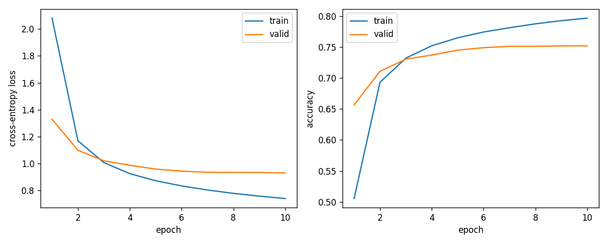

# Anson's 345-class BiLSTM baseline on PSC

This archive records a completed classification experiment for the midterm report. Anson connected Sihui's preprocessed QuickDraw data to Mae's existing BiLSTM training/evaluation pipeline with a separate PSC data adapter. The original model and training loop were unchanged. Training started from scratch with cross-entropy; this was not fine-tuning, a Sketch-RNN VAE, or a Transformer experiment.

## Results

- Best validation accuracy: **75.19%** (172,500 sketches; loss 0.9287088905).
- Test accuracy: **75.40%** (172,500 sketches; loss 0.9220792236).
- Final training accuracy: **79.68%**.
- The highest-validation-accuracy checkpoint was selected at epoch 10 and then evaluated on the test split on October 16, 2026. Test results were not used to select this checkpoint.



The exact values are in [metrics_valid.json](metrics_valid.json), [metrics_test.json](metrics_test.json), and [history.json](history.json). The curves show training and validation only; the test result is a separate evaluation.

## Data and evaluation protocol

- All **345 categories**, with a sampled subset within each category: **5,000 training**, **500 validation**, and **500 test** sketches per category. Total training size: **1,725,000**. This does **not** use every available QuickDraw sketch or the entire available test split.
- Input: Sihui's `data_preprocessing/preprocess.ipynb` output, `data/processed_full/<category>/{train,valid,test}.npz` plus `manifest.json`. These are the **full** archives, not a concatenation of standard and full archives.
- Original train/validation/test split boundaries were preserved.
- Representation: variable-length stroke-3 sequences `(dx, dy, pen_up)`, float32. Batches were padded with lengths passed to the packed LSTM.
- Preprocessing scaled each sketch's longest bounding-box dimension to one, then used a shared standard deviation fitted on training data. The adapter used scale factor **1.0**, avoiding a second normalization.
- At model input, sketches longer than **250 points were excluded**, not truncated. Preprocessing itself retained variable-length sketches.
- Sampling used NumPy `default_rng(42)`: one fresh generator per split, categories in manifest class-index order, selecting without replacement after the length filter and sorting selected indices back into source order. This detail matters when reproducing the exact subset.
- Global labels were checked against the preprocessing manifest and mapped to classifier category order. The adapter checked shape, finite coordinates, binary pen flags, source ID format, unique IDs, and disjoint training/validation IDs.
- Training and validation sample-ID lists remain with the PSC run; these large files and the dataset are not included in this archive. Test sample IDs were not separately exported by the evaluation command.

## Model and training settings

- One-layer **bidirectional LSTM**, hidden size **256 per direction**, last-state pooling, 512-dimensional embedding, linear 345-class head; dropout 0.
- Cross-entropy loss; Adam, learning rate **0.001**, weight decay 0, gradient clipping 1.0.
- **10 epochs**, batch size **128**, seed **42**, no augmentation added by the adapter.
- PSC Bridges-2: one V100-32 GPU, five requested CPU cores, module `pytorch/26.05-2.11-py3` (training log reports torch `2.11.0+cu126`). Exact package versions are recorded in the archived logs. A seed alone does not guarantee bitwise-identical results on different hardware/software.

See [config.json](config.json) for the exact resolved settings and category order, and the class-count files for the sampled training/validation sizes.

## Code version and provenance

- Mae's model/pipeline commit used for this run: [`5fe0e29ee627d1a36f979a52a7659eca2c761878`](https://github.com/imalovelesspender/vector-sketch-classification/commit/5fe0e29ee627d1a36f979a52a7659eca2c761878), October 10, 2026.
- The preprocessing notebook used had SHA-256 `af55d144d5bee88d56fa4d3e71a76fd525612a51db1a4290f15dd28083cdf11c`.
- The preprocessing manifest hash is recorded in `config.json` under `data.preprocessing.manifest_sha256`.
- Training job: **49207027**, October 14, 2026. Test evaluation job: **49341754**, October 16, 2026.
- Best-checkpoint SHA-256: `8f467f9fc1b22ddedb6ec364252374ae67104ab64fa027ecfd456e6834677766`. The test log shows the same hash before and after evaluation.
- Mae's October 17 commit [`dd84ba3`](https://github.com/imalovelesspender/vector-sketch-classification/commit/dd84ba3fc43be6d0203c07f32fcdae3335ada45b) subsequently added processed-data support to the shared pipeline. **These results predate that update** and use the archived adapter instead. Equivalence of sample selection with the newer reader has not been established.

## Archived execution files

- `run_processed.py`: processed-shard adapter and the earlier three-class diagnostic entry point. For this 345-class result, `run_all345.py` imports its adapter; do not invoke its three-class `main()` to reproduce this result.
- `run_all345.py`: selects all 345 categories, loads the sampled data, saves provenance/counts/IDs, runs Mae's original training loop, and reloads the best checkpoint for validation.
- `train_all345.sbatch`: exact training submission script used on PSC.
- `evaluate_test.sbatch`: exact evaluation script; it requires an allocated GPU and uses the saved best checkpoint. Its resource request was supplied when submitted, not embedded as `#SBATCH` directives.
- `train345-49207027.log` and `test-49341754.log`: actual execution logs. The training log's final "TEST SPLIT UNTOUCHED" refers to October 14; test evaluation was performed separately on October 16.

These scripts are an **archive**, not a replacement for the current shared pipeline. Their absolute PSC paths refer to the original run location. No new training was performed to prepare this archive.

## Reproducing this historical run

1. In a separate checkout, check out the pinned October 10 commit above and prepare the same processed data/manifest. Use the archived `config.json` to verify the manifest hash and original settings. The newer pipeline's default configuration is not a substitute for this historical setup.
2. Copy `run_processed.py` and `run_all345.py` from this archive into that checkout's `psc_run/` directory. The adapter locates `src/` relative to that directory.
3. In a PSC GPU allocation with the module listed above, run from the checkout root:

```bash
python -u psc_run/run_all345.py \
  --data-dir /path/to/data/processed_full \
  --output-dir results/lstm_345_reproduction
```

The output directory must not already exist. For batch submission, adapt the archived training script's account, paths, and output directory to the new checkout. Do not overwrite the original experiment.

4. To evaluate that reproduction's validation-selected checkpoint under the historical adapter, from the checkout root in a GPU allocation:

```bash
python - <<'PY'
from psc_run import run_processed as adapter
adapter.evaluation.build_datasets = adapter.build_prepared
adapter.evaluation.evaluate(
    'results/lstm_345_reproduction/best.pt', split='test', device='cuda')
PY
```

The checkpoint stores the data path/config, so that processed-data directory must remain accessible. Weights are not committed here; the original `best.pt`, large sample-ID lists, and processed data remain on PSC under the original experiment directory recorded in `config.json`.

## Limits and next comparisons

This is one baseline run with one seed and no completed ablation or Transformer comparison. It does not establish that these settings are optimal. For the next comparison, keep category order, sampled sketches, length filtering, preprocessing, and evaluation protocol fixed. Use validation for development; avoid choosing new settings using the already observed test result.
